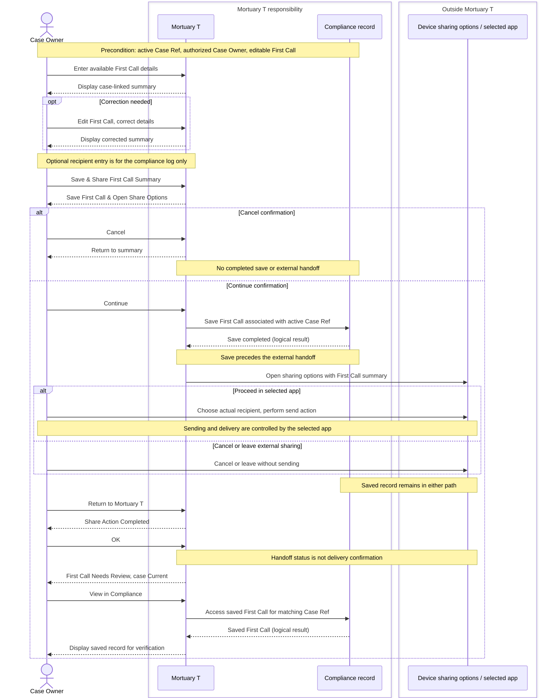

# First Call UML sequence diagram

## Document purpose

This sequence diagram shows the order of interactions when the Case Owner
reviews First Call, saves it to Compliance, and opens external sharing. It
complements the [cross-functional workflow](first-call-swimlane.md) by making
message order and the system boundary explicit.

This is a sanitized, behavior-level UML sequence model. The participants and
messages represent documented responsibilities and observable outcomes, not
production classes, API endpoints, database tables, or a network protocol.



[Open the full-size diagram](../assets/business-analysis/mortuary-t-first-call-sequence.svg){ .md-button }
[Download the editable Mermaid source](../assets/business-analysis/mortuary-t-first-call-sequence.mmd){ .md-button }

## How to read the diagram

Read from top to bottom. Solid arrows represent actions or requests; dashed
arrows represent displayed responses or logical results. An **opt** fragment
shows an optional correction. Each **alt** fragment shows mutually exclusive
paths. The boxes distinguish Mortuary T's responsibility from external sharing.

| Participant | Responsibility |
| --- | --- |
| Case Owner | Records and reviews details, confirms or cancels, chooses the actual recipient externally, and verifies the saved record. |
| Mortuary T | Maintains case-linked information, saves before sharing, opens sharing options, and displays the resulting record and statuses. |
| Compliance record | Represents the saved case-linked First Call within Mortuary T's responsibility. It does not imply a separate deployed service. |
| Device sharing options / selected app | Groups the device share interface and selected external app for this behavior-level model. Actual recipient selection, sending, and delivery belong outside Mortuary T. |

## Preconditions and scope

- A case has already been created with a unique **Case Ref** and **Case Owner**
  role; First Call begins as **Draft**.
- The Case Owner is authorized to use the action and First Call is editable.
- Draft and form information belong to the active Case Ref.
- Case creation, locking, reopening, and access-denial flows are documented
  separately in the [business requirements](first-call-requirements.md).
- Property Inventory and Witness Signature retain their independent statuses.

## Text alternative

1. The Case Owner records available First Call information. Mortuary T displays
   the summary for the active Case Ref. If corrections are needed, the owner
   selects **Edit First Call**, corrects the details, and reviews again.
2. An optional recipient entry records compliance-log information only. It
   does not choose or preselect the actual message recipient.
3. The owner selects **Save & Share First Call Summary**. Mortuary T displays
   **Save First Call & Open Share Options**.
4. If the owner cancels this confirmation, Mortuary T returns to the summary
   without completing this save-and-share action. This does not mean that
   existing drafts or previously saved records are deleted.
5. If the owner selects **Continue**, Mortuary T saves First Call to Compliance
   for the active Case Ref. Only after that save does it open device sharing
   options with the summary.
6. The user may select an external app, choose the actual recipient, and perform
   that app's sending process, or cancel or leave external sharing. In either
   path, the completed Compliance save remains available.
7. On return, Mortuary T displays **Share Action Completed**, which the owner
   acknowledges with **OK**. This describes a sharing handoff, not confirmed
   delivery. First Call displays **Needs Review** and the case is **Current**.
8. The owner selects **View in Compliance** and verifies the saved First Call
   for the matching Case Ref.

## Boundaries and interpretation

!!! important "Saving, handing off, and delivering are distinct"
    The Compliance save occurs before external sharing opens. Canceling external
    sharing does not undo that save. Mortuary T does not confirm message
    delivery; verify delivery in the selected app when needed.

The save-completed and record-return arrows are logical results used to express
ordering and availability. They do not assert a particular storage mechanism,
callback, transaction, or server acknowledgment. Returning to Mortuary T is
shown as a user action, not a delivery receipt from the external app.

The diagram covers the documented successful save and cancellation paths. The
source artifacts do not establish detailed save-failure, unavailable-sharing,
or retry behavior; those paths are not invented here.

## Requirements and evidence

| Interaction or control | Requirements / acceptance criteria | Existing evidence |
| --- | --- | --- |
| Case-linked entry and summary correction | FR-FC-02–04; AC-FC-02–04 | UAT-FC-02–03 |
| Optional recipient is log information only | FR-FC-05; AC-FC-05 | UAT-FC-04 |
| Save completes before sharing opens | FR-FC-06; AC-FC-06 | UAT-FC-04 |
| External cancellation preserves the save | FR-FC-07; AC-FC-07 | UAT-FC-05 |
| Needs Review, Current, and Compliance availability | FR-FC-08; AC-FC-08 | UAT-FC-04 |
| Handoff does not confirm delivery | BR-FC-02; NFR-FC-03 | UAT-FC-04–05 |
| Independent document statuses | FR-FC-09; AC-FC-09 | UAT-FC-06 |
| Matching active Case Ref | NFR-FC-01; AC-FC-13 | UAT-FC-10, pass after retest |
| Cancel Mortuary T confirmation before proceeding | Swimlane confirmation decision | Documented in PR #6; no separate UAT scenario is claimed |

Source baseline: repository commit
[`e4e8ad0`](https://github.com/ryansplan/mortuary-t-docs/commit/e4e8ad0242a0f9e30723778bbb4a087f8b254ab5),
including the swimlane merged in
[PR #6](https://github.com/ryansplan/mortuary-t-docs/pull/6).
The [UAT page](first-call-uat.md) identifies its results as a sanitized
reconstruction of a completed cycle. This diagram maps that existing evidence;
it does not claim a new device test or production-code audit.

## Maintain the artifact

Edit the Mermaid source and regenerate the adjacent SVG with Mermaid CLI:

```shell
mmdc -i docs/assets/business-analysis/mortuary-t-first-call-sequence.mmd -o docs/assets/business-analysis/mortuary-t-first-call-sequence.svg -b white
```

Commit the source and SVG together. The page embeds the static SVG so readers
can view it without a client-side Mermaid renderer. Update the text alternative
and traceability table whenever the interaction order changes.

## Related artifacts

- [Create and share a First Call summary](../getting-started/index.md)
- [First Call cross-functional workflow](first-call-swimlane.md)
- [First Call business requirements](first-call-requirements.md)
- [First Call requirements traceability](first-call-traceability.md)
- [First Call UAT plan and results](first-call-uat.md)
